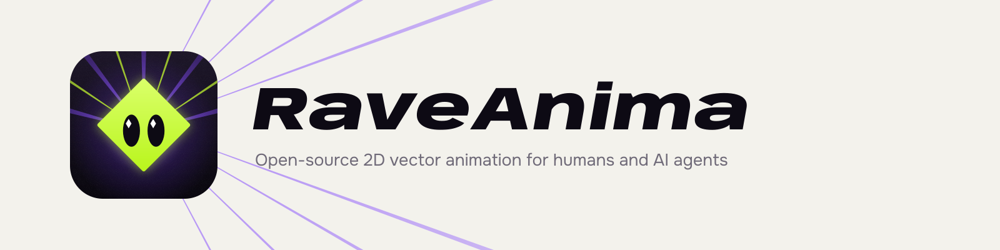

<p align="center">
  <picture>
    <source media="(prefers-color-scheme: dark)" srcset="brand/readme-banner-dark.png">
    
  </picture>
</p>

# RaveAnima

Desktop editor for 2D vector design and keyframe animation, built so that people and AI agents use the same tools.
An open-source, local-first alternative to Rive, with Lottie as a first-class export.

- **Draw**: rectangles, ellipses, polygons, stars, pen paths with editable points, text, images, groups, solid and gradient fills, strokes, trim paths. SVG import turns files into native editable shapes.
- **Animate**: timelines with loop / ping-pong, keyframes on any numeric or colour property, path morphing, easing presets and a cubic-bezier editor, auto-key in Animate mode, animation presets.
- **Interact**: state machines with inputs, states, transitions and pointer listeners, played by the `<anima-player>` web component.
- **Export**: Lottie JSON (lottie-web, iOS, Android, Flutter, Skottie), a self-contained interactive HTML page, MP4, GIF, WebM with alpha, MOV, SVG, PNG.
- **For agents**: every action is a typed command with undo. Agents drive the open window live, or work headless without any window, through MCP or the CLI.

Documents are plain JSON (`.anima`), easy to diff, review and generate.

## Requirements

- Node.js 22.12 or newer and npm.
- `ffmpeg` on `PATH` for video and GIF export (CLI and desktop).
- For the desktop app only: Rust (stable) and the [Tauri 2 prerequisites](https://v2.tauri.app/start/prerequisites/) for your OS. The bundle config targets Linux (`.deb`, `.AppImage`).

## Quick start

```bash
git clone https://github.com/vibecoderkz/raveanima.git
cd raveanima
npm install
npm test                       # core tests
npm run build                  # tests + typecheck + player, CLI and desktop web bundles (no Rust needed)
npm run desktop                # Tauri dev window (needs Rust)
npm run desktop:build          # .deb and .AppImage
```

## CLI

```bash
npx raveanima new hello.anima --width 1080 --height 1080
npx raveanima run hello.anima node.add '{"type":"rect","props":{"width":200,"height":200,"fill":"#FF3B2E"}}'
npx raveanima export hello.anima hello.png
npx raveanima export hello.anima hello.json     # Lottie
npx raveanima commands                          # every command with its description
npx raveanima --help
```

Commands: `new | inspect | run | batch | export | sheet | commands | guide | mcp`. The CLI bundle is committed at
`packages/headless/dist/anima.js`, so it works right after `npm install`; `npm run build` regenerates it.

## Agents (MCP)

```bash
# Drive the open window (you watch every step, Ctrl+Z undoes it)
claude mcp add raveanima -- node /path/to/raveanima/packages/headless/dist/anima.js mcp --live

# No window: in-memory document, render previews as images
claude mcp add raveanima-headless -- node /path/to/raveanima/packages/headless/dist/anima.js mcp
```

MCP tools: `anima_guide`, `command_list`, `command_run`, `command_batch`, `doc_inspect`, `doc_open`, `doc_import`,
`export`, `render_preview`, `render_contact_sheet`.

The live bridge listens on `127.0.0.1:47900` only, needs the bearer token the app writes to
`~/.config/anima/bridge.token` (mode 600) on launch, and refuses any request that carries a browser `Origin`.

## Web player

`raveanima export file.anima page.html` writes one self-contained page with the player inside. To embed it yourself,
build the player (`npm run build -w @raveanima/player`) and load `packages/player/dist/anima-player.iife.js`:

```html
<script src="anima-player.iife.js"></script>
<anima-player src="owl-interactive.anima" state-machine="Owl"></anima-player>
```

Attributes: `src`, `state-machine`, `animation`, `fit` (`contain` or `cover`), `paused`.

## Examples

`examples/` holds scripts that build documents only through commands, the same way an agent does over MCP:

```bash
npx tsx examples/owl.ts               # writes examples/owl.anima
npx tsx examples/owl-interactive.ts   # adds hover and click states
```

## Layout

| Path | What |
| --- | --- |
| `packages/core` | Document model, command registry with undo, animation evaluation, state machines, renderer (Canvas2D API), SVG import, SVG and Lottie export. Pure TypeScript, no DOM needed. |
| `packages/headless` | Skia rendering (`@napi-rs/canvas`), ffmpeg video, the `raveanima` CLI and the MCP server. |
| `packages/player` | `<anima-player>` web component for any web page. |
| `apps/desktop` | Tauri 2 app: React UI in the webview, Rust shell for files, video export and the agent bridge. |
| `replica/` | Clean-room recon of Rive (public docs and the MIT runtime only) and the feature matrix. |

## Names kept for compatibility

The project was called Anima during development. These identifiers keep that name so existing files, scripts and
agent setups keep working: the `anima` CLI command (an alias of `raveanima`), the `.anima` file extension and its
`"format": "anima"` field, MCP tool names such as `anima_guide`, the `<anima-player>` element, the bundle path
`packages/headless/dist/anima.js`, and the bridge token path above.

## Fonts

The UI is designed for SF Pro. Apple's font license does not allow redistribution, so this repository ships no font
files. If SF Pro is installed on your system it is used automatically; you can also place `SF-Pro-Text-Regular.otf`,
`SF-Pro-Text-Semibold.otf`, `SF-Pro-Display-Semibold.otf` and `SF-Pro-Display-Bold.otf` from
[developer.apple.com/fonts](https://developer.apple.com/fonts/) into `apps/desktop/public/fonts/`. Without them the
UI falls back to the system sans-serif.

## Clean room

RaveAnima is an independent implementation. Rive was studied only through its public documentation and its
MIT-licensed runtime sources; no Rive editor binary, code, assets or file was used. Rive is a trademark of its owner,
and this project is not affiliated with it.

## License

[MIT](LICENSE). Copyright (c) 2026 Dias Zhumagaliyev.

---

Developed by Dias Zhumagaliyev: https://dias.now · hello@dias.now
