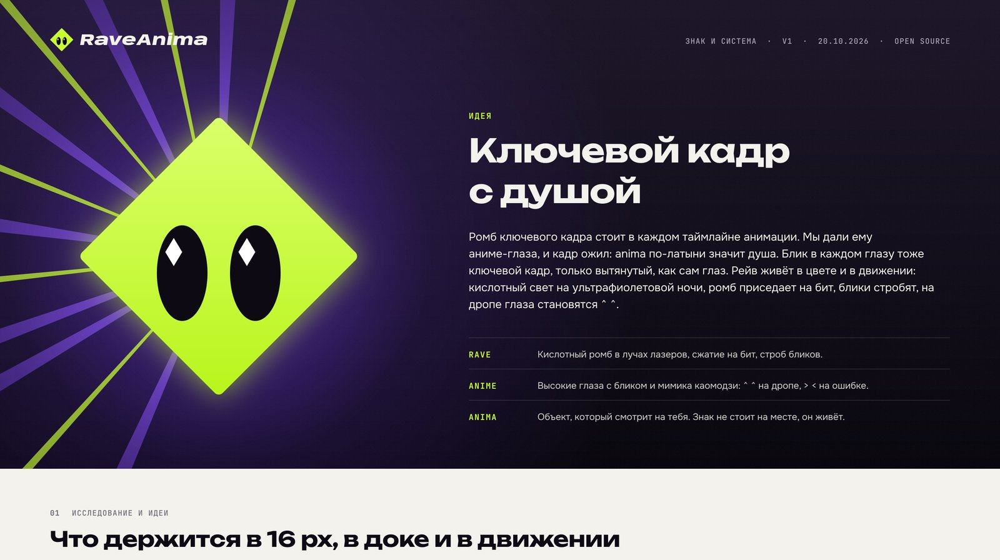

# RaveAnima brand

The sign is a keyframe diamond, the shape that sits on every animation timeline, with anime eyes: a keyframe with a
soul (*anima* is Latin for soul). Rave lives in the colour and the motion: acid light on an ultraviolet night, the
diamond squashes on the beat, the highlights strobe, and on the drop the eyes turn into `^ ^`.

## Colours

| Name | Hex | Use |
| --- | --- | --- |
| Acid | `#C8FF2E` | The sign and one accent. Only on dark or at large sizes. |
| Night | `#0D0A14` | Ink, text, dark scenes. The main background. |
| UV | `#7A3CFF` | Glow, lasers, plates. Text on UV is white only. |
| Paper | `#F3F2EC` | Light backgrounds for documents and the README. |
| Strobe | `#FFFFFF` | Eye highlights and one-frame flashes. |

Contrast: Night on Acid 16.6:1, Paper on Night 17.5:1, white on UV 5.4:1. Acid on a light background is 1.1:1, so on
light the sign is drawn in Night (`raveanima-sign-night.svg`) or sits on a Night plate.

## Rules

- Keep clear space around the sign and the lockups of at least one eye height (34 units on the 100-unit grid).
- Minimum size: the sign at 16 px (pixel master), the horizontal lockup at 120 px wide or 25 mm in print.
- Do not rotate, stretch, outline or recolour the sign beyond the files here. The eyes always look at the viewer.
- The wordmark is set in Anybody Italic (width 130, weight 850, tracking -6/1000 em) and outlined in every SVG, so no
  font is needed to use these files. Anybody: Copyright 2020 The Anybody Project Authors
  (https://github.com/Etcetera-Type-Co/Anybody), SIL Open Font License 1.1.

## Files

| File | What |
| --- | --- |
| `raveanima-sign.svg` | The sign in colour (for dark backgrounds) |
| `raveanima-sign-acid.svg`, `-night.svg`, `-white.svg` | One-colour signs |
| `raveanima-wordmark-night.svg`, `-paper.svg` | The wordmark alone |
| `raveanima-lockup-horizontal-{light,dark,uv,white}.svg` | Sign and wordmark in a row |
| `raveanima-lockup-stacked-{light,dark}.svg` | Sign above the wordmark |
| `icon-1024.png`, `favicon.svg` | App icon master and favicon |
| `readme-banner-{light,dark}.{png,svg}` | README banners |
| `social-preview.{png,svg}` | GitHub social preview (1280×640) |
| `github-avatar.png` | Avatar |

App icons for the desktop build live in `apps/desktop/src-tauri/icons/`: the 32 and 64 px icons and the `.ico` use
hand-tuned small masters, the rest are generated from `icon-1024.png` with `tauri icon`.
